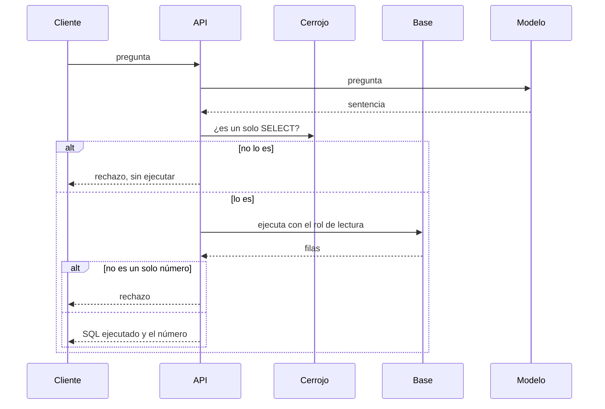

# ARCHITECTURE — Numera

Estado: Aprobada
Fecha: 2026-10-27

Este documento manda sobre el código de esta versión. Las decisiones caras de revertir están en [los ADR](../adr/README.md).

- [CONTEXT.md](CONTEXT.md) — quién usa el sistema y qué queda fuera
- [DATA.md](DATA.md) — esquema, semilla y forma del número
- [EVALUATION.md](EVALUATION.md) — qué número cuenta y qué número no
- [SECURITY.md](SECURITY.md) — qué está cerrado y qué hueco se admite

## Forma

Un proceso. Una base PostgreSQL. Sin microservicios: no hay un límite de dominio que justifique otro despliegue.

El modelo propone la sentencia. El servidor decide si se ejecuta, la ejecuta con el rol de lectura y publica esa sentencia junto al valor. Una frase del modelo, sin número ejecutado, no es la respuesta. [ADR-0001](../adr/0001-truth-is-the-executed-number.md). [ADR-0002](../adr/0002-server-runs-the-statement.md).

## Módulos

| Módulo | Puede importar | No puede |
| --- | --- | --- |
| `domain` | nada de infraestructura | Postgres, HTTP, el parser SQL, el SDK del modelo |
| `application` | `domain` y puertos | drivers concretos |
| `infrastructure` | puertos | handlers HTTP |
| `api` | casos de uso | SQL y el driver |

Un test de arquitectura falla si `domain` o `application` importan infraestructura, el API, el driver o el parser.

## Contrato HTTP

`POST /v1/answers`

Entrada: `question` (texto no vacío, tope de longitud).

Salida 200:

- `refused: false`, `sql` (la sentencia ejecutada), `value` (el número decimal, o `null` si la celda es nula)
- o `refused: true`, `reason` (`rejected_sql` o `not_a_number`), `sql` (la sentencia que no se ejecutó, o la que se ejecutó y no era un número), `value: null`

No es un error de transporte que la sentencia esté prohibida o que el resultado no sea un número. El error es de entrada, del modelo o de la base.

Errores en `application/problem+json`:

| Caso | Estado |
| --- | --- |
| Pregunta vacía, cuerpo ilegible, pregunta por encima del tope | 400 |
| El modelo no responde a tiempo | 504, sin reintento |
| El modelo responde algo que no es una sentencia, después de un reintento | 502 |
| La base no está | 503, sin la cadena de conexión |

Cada respuesta lleva `request_id`. El log incluye latencias, nombre del modelo, tokens, la pregunta, la sentencia, si hubo rechazo y cuántas filas volvieron. No incluye la clave ni la contraseña del rol.

## Qué no se esconde

Esta versión no puntúa la prosa. Puntúa si el número ejecutado es el número de oro. Una sentencia válida con el número equivocado es un fallo de accuracy, y la respuesta igual se entrega: el analista ve el SQL y el valor.

Tampoco hay un umbral de “SQL bastante parecido”. O el valor decimal coincide, o no.

## Idioma

El esquema, la semilla, las preguntas, el README, la API, los tests y los commits de esta versión están en inglés. Esta arquitectura y los ADR están en español. [ADR-0008](../adr/0008-public-warehouse-is-english.md).

## Versión siguiente, todavía no

Un modelo de pago, en una corrida fechada, cuando el accuracy del sustituto ya esté impreso. Medir si una pregunta en lenguaje natural consigue proponer una sentencia prohibida. Identidad antes de conectar un warehouse que no sea sintético. AWS cuando el servicio ya corra en Docker, con el mismo contenedor, el coste de dejarlo encendido y el comando para apagarlo, sin NAT gateway.
